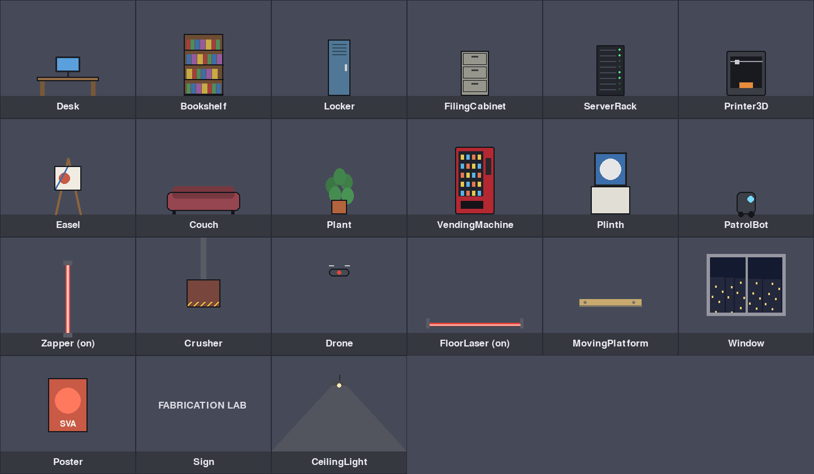

# The kit

Ready-made parts for your floor, in `engine/kit/`, one file per part, so each part can have an owner
(OWNERS.md). Import what you need; to change a part, make a pull request to that part (its owner reviews).
To add a part, add a file `engine/kit/<part>.py` with `__all__ = ["YourPart"]` and claim it. `floors/example_kit_floor.py` uses most of it across three rooms.



```python
from engine import config as C
from engine.kit import Desk, Locker, Crusher, MovingPlatform, Window, Sign
```

Positions work the way the engine does: `x` is the left edge, and for anything that stands on something,
`y` is the surface it stands on (its **bottom**): `C.FLOOR_Y` for the floor, or a ledge's `y`.

## Furniture: `self.furniture`
Searchable. Add `holds_piece=True` to the one that hides your digit. Every one takes
`(x, y, name=None, holds_piece=False, w=None, h=None)`; leave `w`/`h` out for its normal size.

| part | normal size | |
|---|---|---|
| `Desk` | 110 x 70 | desk with a monitor |
| `Bookshelf` | 70 x 110 | |
| `Locker` | 40 x 100 | |
| `FilingCabinet` | 50 x 80 | |
| `ServerRack` | 50 x 90 | blinking lights |
| `Printer3D` | 70 x 80 | the nozzle moves |
| `Easel` | 60 x 100 | |
| `Couch` | 130 x 50 | |
| `Plant` | 44 x 80 | |
| `VendingMachine` | 70 x 120 | |
| `Plinth` | 70 x 50 | gallery plinth with a piece on top; `colors=(piece, accent)` |

## Hazards: `self.hazards`
| part | arguments | what it does |
|---|---|---|
| `PatrolBot` | `(x, y, left, right, speed=90, sees=True)` | rolls between `left` and `right`; if it sees you in front, it speeds up |
| `Zapper` | `(x, y_top, y_bottom, on_time, off_time, offset)` | a beam, floor to ceiling, on and off |
| `Crusher` | `(x, y_top, y_bottom=C.FLOOR_Y, w=60, h=50, offset=0)` | waits up, slams down, rises slowly |
| `Drone` | `(x, y_top, y_bottom, speed=70, offset=0)` | hovers up and down |
| `FloorLaser` | `(x_left, x_right, y=C.FLOOR_Y, on_time, off_time, offset)` | a low beam to jump while it's on |

Use `offset` (seconds) so two of the same hazard take turns.

## Platforms: `self.platforms`
| part | arguments | |
|---|---|---|
| `Platform` (engine.room) | `(x, y, width)` | a ledge you jump up through and land on |
| `MovingPlatform` | `(x_left, x_right, y, width=110, speed=70, offset=0)` | slides left and right and carries you; don't put furniture on it |
| `Lift` (engine.room, in `self.lifts`) | `(x, y_top, y_bottom, width=64)` | stand on it, hold UP/DOWN; goes home when you leave it |

## Decor: `self.decor`
Only to look at: drawn on the wall behind everything, never in the way, free to draw.

| part | arguments |
|---|---|
| `Window` | `(x, y, w=140, h=110, seed=0)`: night skyline; change `seed` for a different one |
| `Poster` | `(x, y, text="SVA", color=(200, 90, 70), w=70, h=96)` |
| `Sign` | `(x, y, text, color, size=28)` |
| `CeilingLight` | `(x, cord=50, reach=300)` |

## Your own parts
Anything the kit doesn't have, write as a class in your floor file (see `SweepBeam` in
`floors/example_floor.py`): a hazard needs `.rect`, `.update(dt, room, player)` and `.draw(surf)`; furniture
subclasses `Furniture` and overrides `draw`. If it's good enough for everyone, move it into the kit as a new
part in its own pull request, and claim it.

To redraw `docs/kit.png` after changing the kit: `python -m engine.kit_catalog`.
